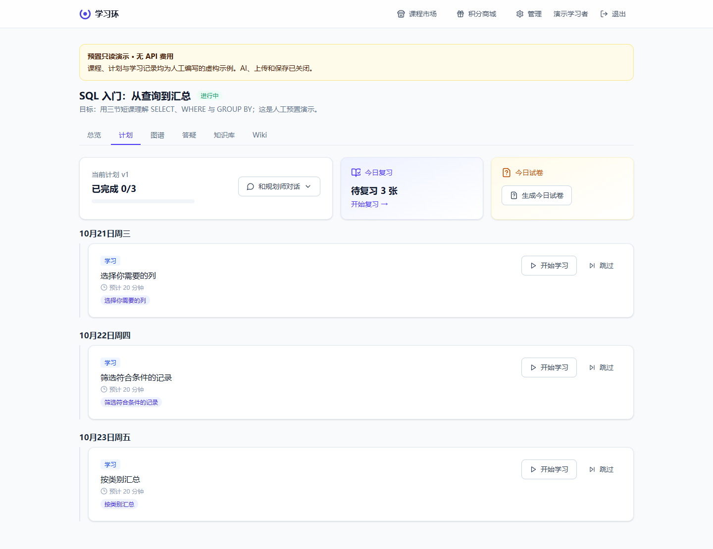

# 学习环 LearnLoop

**把自己的学习资料，变成每天可执行的学习计划与间隔复习。**

[English](README.en.md) · [演示路线](docs/demo-guide.md) · [架构与限制](docs/architecture.md) · [贡献方式](CONTRIBUTING.md)



学习环适合希望围绕自己的教材、笔记和文章持续学习的人。它把资料整理、Wiki、学习计划、主动回忆、测评和 FSRS 复习连接在一起；支持多用户和自行部署。

当前是等待作者审阅的公开发布候选版。界面为中文，学习日界按 Asia/Shanghai 计算。截图均来自本机虚构演示，不是实际用户记录或 AI 效果评测。

## 先体验：无需 API 密钥

需要 Docker Engine/Desktop 与 Docker Compose v2；首次启动需要联网下载镜像和依赖。

```bash
docker compose -f docker-compose.demo.yml up -d --build
```

打开 **http://localhost:8088**，账号 `demo`，密码 `learnloop-demo-only`。

演示包含人工预置的原创 SQL 教材、三天计划、Wiki、图谱与复习卡。可浏览和翻卡，生成、上传、评分与其他保存操作关闭。不会调用模型；演示服务位于独立内部网络，只监听本机端口。预置示例不代表模型生成质量。

[查看实际浏览器录屏（WebM，无配音）](docs/demo-walkthrough.webm)

停止演示并保留其数据：

```bash
docker compose -f docker-compose.demo.yml stop
```

## 创建自己的实例

需要 Docker Compose 和 Python 3.10+（只用于生成本地配置；后端容器使用 Python 3.12）。

```bash
python tools/setup.py
```

该命令生成带随机数据库密码、管理员密码和邀请码的 `.env`，不会覆盖已有文件，也不把密码打印到终端。用本机编辑器打开 `.env`，填写：

| 配置 | 含义 |
| --- | --- |
| `DEEPSEEK_BASE_URL` | OpenAI-compatible Chat Completions 服务地址；变量名保留历史兼容性 |
| `DEEPSEEK_API_KEY` | 自己的服务密钥 |
| `MODEL_LOW` | 服务商账户实际可用的模型 ID |

普通知识课程可先用一个模型；未填写的中、高档模型继承低档模型。需要不同服务时再填写 `MODEL_MEDIUM`、`MODEL_HIGH`、`HIGH_BASE_URL` 与 `HIGH_API_KEY`。配置一个兼容地址不代表其支持所有扩展功能。

```bash
docker compose up -d --build
```

打开 **http://localhost:8080**，用 `.env` 中的管理员账号登录。初次启动自动执行 Alembic 迁移。进入课程页创建知识课程，上传 [`examples/sql-basics.md`](examples/sql-basics.md)，等待入库，再与规划师沟通目标并生成计划。

Markdown/TXT 入库不需要文档解析服务。PDF、DOCX 和 EPUB 有本地解析路径；旧版 Office 格式及部分复杂文档需要可选 MinerU 服务。英文自动找文章需要上游支持联网检索扩展，默认关闭，可先手动导入材料。

## 能做什么

| 环节 | 实现 |
| --- | --- |
| 整理资料 | 文档解析、保留原件、版本化 Wiki，长文入库可断点续跑 |
| 安排学习 | 根据目标生成计划，查看知识点、学习材料和概念关联 |
| 练习反馈 | 日常测验、阶段测评、答案解析、薄弱点记录 |
| 持续复习 | FSRS 复习卡、主动回忆、学习活动记录 |
| 英语学习 | 能力测评、词汇、阅读与写作路径，部分功能依赖模型服务能力 |
| 自行管理 | 邀请注册、按课程隔离、调用记录、费用估算、课程市场 |

这些功能未证明能提升特定考试成绩；模型生成内容和评分需要使用者核对。

## 费用与数据

- 软件自行部署不代表 AI 免费。文档文本、问题和答案可能发送给你配置的模型或解析服务。
- 所有课程，包括管理员课程，默认受每日 token 额度约束；这不是严格的金额上限。建议同时设置服务商侧消费限额。
- 模型价格默认未配置，成本页会显示“未知”。在管理 → 设置填写自己服务的价格，单位为美元/百万 token。已知部分只是估算，账单以服务商为准；旧记录不自动重新计价。
- `pgdata` 保存数据库，`files` 保存上传资料，两者都需要备份。不要对含真实资料的实例执行删除卷命令。
- 默认只监听本机。公开联网前配置 HTTPS、`COOKIE_SECURE=true`、访问控制及备份；演示的公开样例口令不能用于真实实例。

## 验证状态与限制

本候选版已完成本机 Docker 镜像构建、全新 PostgreSQL 16 演示启动、同镜像112条测试及桌面/375px浏览器检查。另用 DeepSeek Flash 和原创 SQL 教材跑通了真实模型入库、计划、出题、批改与复习流程，详情见 [本机实跑记录](docs/local-runtime-acceptance.md)。提供对应 GitHub Actions 工作流。

**GitHub Actions 云端尚未执行**，需要在作者授权的仓库中验证。真实模型验收仅覆盖一次小型知识课程，不代表所有模型、文档格式或英语能力均已验证。系统目前要求单个后端进程，不支持直接增加副本。

遇到首次运行问题：先看 `docker compose logs --tail=100 app`，分享问题前移除密钥、文档内容与个人信息。查看 [架构与限制](docs/architecture.md)、[安全说明](SECURITY.md) 和 [后续计划](docs/ROADMAP.md)。

## 开发与许可

FastAPI · PostgreSQL · React · TypeScript · Vite · FSRS。开发与隔离测试步骤见 [CONTRIBUTING.md](CONTRIBUTING.md)。

主项目许可证待作者决定；当前不声明开源许可。按现有依赖建议采用 **AGPL-3.0-only**，理由及影响见[许可证建议](docs/licensing-proposal.md)。PDF/EPUB解析依赖中包含 AGPL 组件，正式分发前需核对授权方案。参见 [依赖许可说明](docs/third-party-licenses.md)。公开候选包不含原仓库历史、生产配置、真实用户数据、数据库备份或第三方依赖源码。
